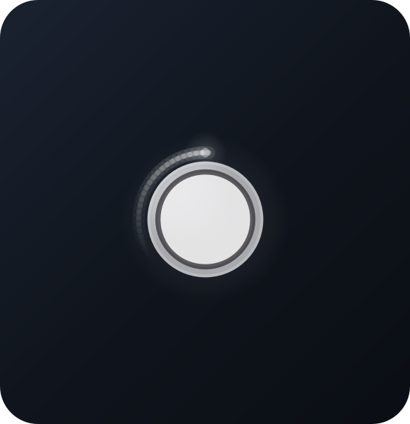
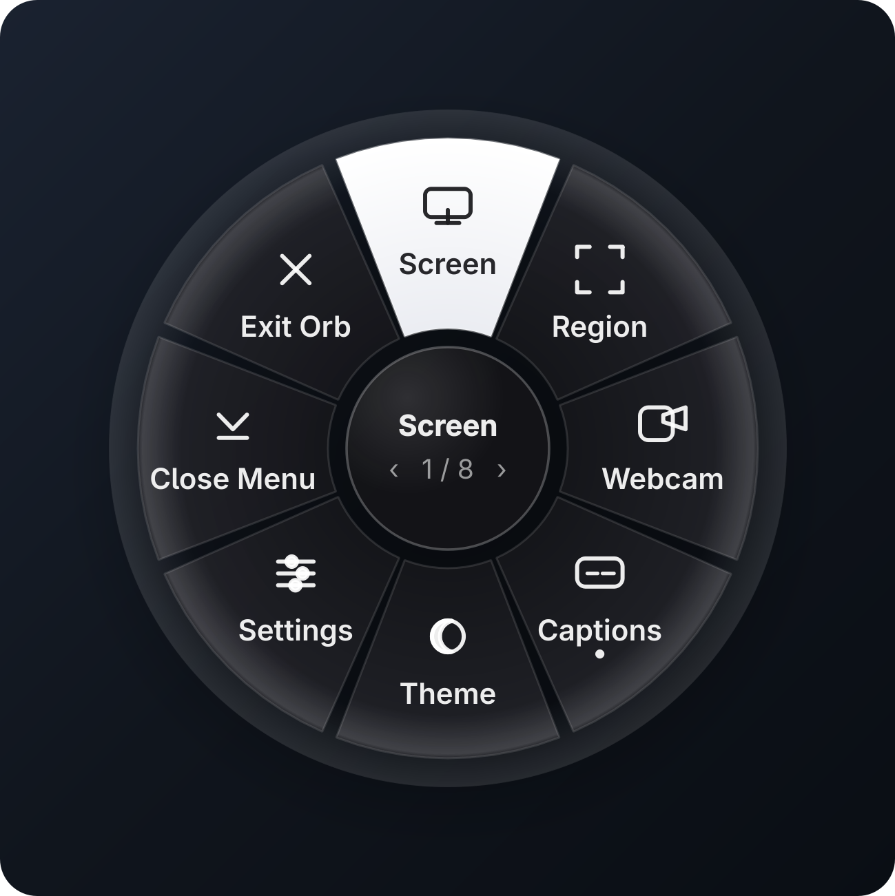
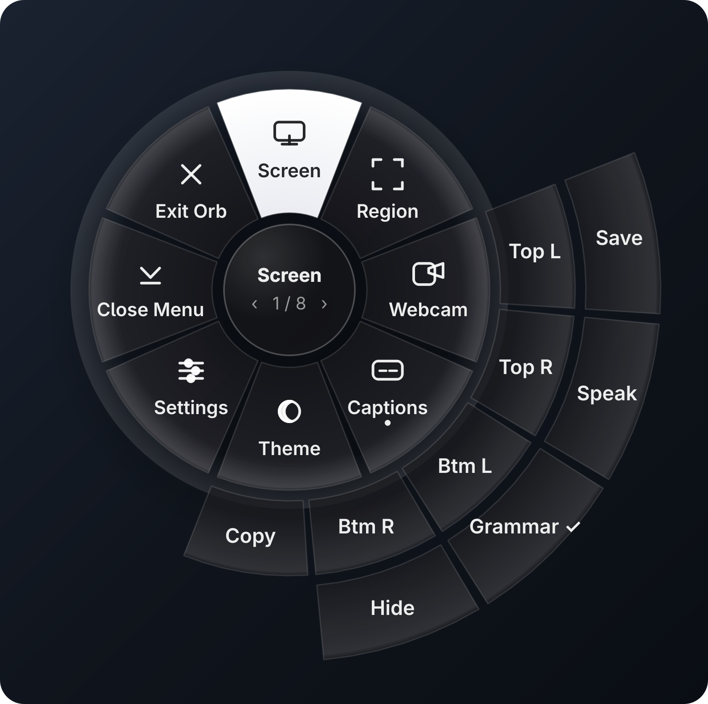

<div align="center">

# SignFlow

### Real-Time Multi-Modal Sign Language Recognition via a 12-Stream Hybrid Architecture on the Full-Vocabulary ASL Citizen Benchmark

[-blue?style=for-the-badge&logo=ieee)](Docs/IEEE_SignFlow.pdf)
[](https://huggingface.co/nithinm2719/SignFlow-ASL-Citizen-SOTA)
[](https://doi.org/10.5281/zenodo.24088419)

-success?style=for-the-badge)

<table>
  <tr>
    <td align="center" width="30%"></td>
    <td align="center" width="35%"></td>
    <td align="center" width="35%"></td>
  </tr>
  <tr>
    <td align="center"><b>The Orb</b><br/><sub>floating on-device assistant</sub></td>
    <td align="center"><b>Tools Wheel</b><br/><sub>instant interactive controls</sub></td>
    <td align="center"><b>Options Menu</b><br/><sub>adaptive recognition settings</sub></td>
  </tr>
</table>

</div>

---

> [!IMPORTANT]
> ### 🔒 Intellectual Property & Peer-Review Availability Notice
> **Manuscript**: *SignFlow: Real-Time Multi-Modal Sign Language Recognition via a 12-Stream Hybrid Architecture on the Full-Vocabulary ASL Citizen Benchmark*  
> **Status**: Formally under peer review at **IEEE Signal Processing Letters** (Manuscript ID: **`SPL-49609-2026`**)  
> **Author**: Nithin G (Independent Researcher · `thangamnithin1980@gmail.com`)  
> **Permanent Archival DOI**: [10.5281/zenodo.24088419](https://doi.org/10.5281/zenodo.24088419)  
> **Hugging Face Model Hub**: [nithinm2719/SignFlow-ASL-Citizen-SOTA](https://huggingface.co/nithinm2719/SignFlow-ASL-Citizen-SOTA)  
>
> **Code Availability**:  
> To safeguard proprietary architecture designs, training recipes, and competitive priority during journal peer review, the end-to-end multi-modal training scripts and model checkpoints are restricted. Complete reproduction pipelines, model weights, and inference packages will be unlocked in this repository immediately upon formal acceptance of the manuscript.

---

## Benchmark Results on Official ASL Citizen Test Split (2,731 Glosses)

The headline figures are evaluated on the complete official **ASL Citizen test split** comprising **32,941 test clips** across **2,731 glosses** under the strict signer-independent protocol (11 unseen test signers never appear in training or validation).

| Model / Architecture | Modality | Top-1 Accuracy | Top-5 Accuracy | Top-10 Accuracy | Notes |
|---|---|:---:|:---:|:---:|---|
| **SignFlow (12-stream hybrid)** | **Landmarks + RGB** | **87.03%** | **98.27%** | **98.88%** | **#1 SOTA (Log-linear fusion fitted on Val)** |
| **SignFlow (`conv3` solo expert)** | **Landmarks only** | **85.15%** | **97.35%** | — | **Single model (No ensemble)** |
| SignFlow (Pure Skeleton 7-stream) | Landmarks only | 85.74% | 97.66% | 98.74% | 4 transformers + 3 conv experts |
| SignFlow (Conv-only 3-stream) | Landmarks only | 85.57% | 97.56% | 98.71% | 3 dilated temporal conv experts |
| *SignBart (CVPR 2025)* | Skeleton | 75.22%* | — | — | Reported on validation split |
| *PoseFormer (2025)* | Skeleton | 75.10% | — | — | Prior benchmark best |
| *I3D Official Baseline (NeurIPS 2023)* | RGB Video | 63.10% | 83.50% | 91.00% | Desai et al. |
| *ST-GCN Official Baseline (NeurIPS 2023)* | Skeleton Graph | 59.52% | — | — | Desai et al. |

* **Statistical Significance**: Signer-clustered 95% bootstrap confidence interval ($B=2{,}000$, seed 0) is **`[84.07%, 89.53%]`**, confirming a statistically significant $+11.93\%$ margin over the strongest prior published baseline ($75.10\%$).
* **On-Device Efficiency**: 72 ms end-to-end latency per clip (13.8 FPS) on an NVIDIA RTX 3070 Ti laptop GPU.

---

## Architecture Overview

SignFlow couples **geometric landmark features** (MediaPipe Holistic: 40 lip contour points, 21+21 hand landmarks, and 10 upper-body joints) with **temporal RGB video representations** via a late log-linear fusion scheme:

```text
       Input Video Stream / Screen Region
                     │
         ┌───────────┴───────────┐
         ▼                       ▼
  MediaPipe Landmarks       RGB Frames
  (92 points / frame)     (Subsampled clips)
         │                       │
  ┌──────┴──────┐                ▼
  ▼             ▼         RGB Video Experts
Transformers  Conv1D      (V-JEPA / VideoMAE)
(4 streams)  (3 streams)         │
  └──────┬──────┘                │
         ▼                       ▼
  Skeleton Logits          RGB Logits
         └───────────┬───────────┘
                     ▼
          Log-Linear Fusion Layer
         (Weights fitted on Val)
                     │
                     ▼
        Top-1 Prediction (87.03%)
```

---

## Manuscript & Documentation

* **Compiled Research Paper**: [`Docs/IEEE_SignFlow.pdf`](Docs/IEEE_SignFlow.pdf)
* **System Overview & Architecture Slides**: [`Docs/SignFlow_Overview.pdf`](Docs/SignFlow_Overview.pdf)
* **Bootstrap Validation Logs**: [`results/bootstrap_results.json`](results/bootstrap_results.json)
* **Research Methodology**: [`RESEARCH.md`](RESEARCH.md)

---

## Citation

```bibtex
@article{nithin2026signflow,
  title   = {SignFlow: Real-Time Multi-Modal Sign Language Recognition via a 12-Stream Hybrid Architecture on the Full-Vocabulary ASL Citizen Benchmark},
  author  = {Nithin G},
  journal = {IEEE Signal Processing Letters (Under Review)},
  year    = {2026},
  doi     = {10.5281/zenodo.24088419},
  url     = {https://doi.org/10.5281/zenodo.24088419}
}
```

---

## License

This project is distributed under the terms of the [MIT License](LICENSE).  
Copyright © 2026 Nithin G. All rights reserved.
