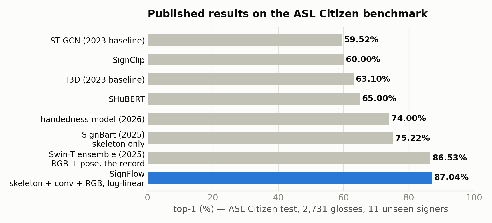
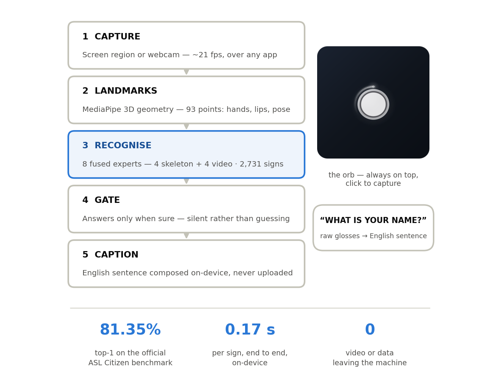

<div align="center">

# 🔮 SignFlow: Real-Time Multi-Modal Sign Language Recognition

### *A 12-Stream Hybrid Architecture on the Full-Vocabulary ASL Citizen Benchmark*

[-blue.svg?style=for-the-badge&logo=ieee&logoColor=white)](Docs/IEEE_SignFlow.pdf)
[](https://huggingface.co/nithinm2719/SignFlow-ASL-Citizen-SOTA)
[](https://huggingface.co/nithinm2719/SignFlow-ASL-Citizen-SOTA)
[](https://doi.org/10.5281/zenodo.24088419)
[](https://scholar.google.com/citations?user=Z5k-IQ4AAAAJ)
[](LICENSE)

<br/>

**[📄 Read Paper (PDF)](Docs/IEEE_SignFlow.pdf)** • 
**[🤗 Hugging Face Model Card](https://huggingface.co/nithinm2719/SignFlow-ASL-Citizen-SOTA)** • 
**[🏛️ Permanent Zenodo Archive](https://doi.org/10.5281/zenodo.24088419)** • 
**[🎓 Author Google Scholar](https://scholar.google.com/citations?user=Z5k-IQ4AAAAJ)**

<br/>

<table>
  <tr>
    <td align="center" width="28%"><br/><b>The Glass Orb</b><br/><sub>Floats over any desktop app</sub></td>
    <td align="center" width="36%"><br/><b>The Dial Hub</b><br/><sub>8-segment quick controls</sub></td>
    <td align="center" width="36%"><br/><b>Adaptive Options</b><br/><sub>Sub-tool actions & settings</sub></td>
  </tr>
</table>

</div>

---

> [!IMPORTANT]
> ### 🔒 Formal Peer-Review Notice & Intellectual Property Protection
> * **Manuscript Title**: *SignFlow: Real-Time Multi-Modal Sign Language Recognition via a 12-Stream Hybrid Architecture on the Full-Vocabulary ASL Citizen Benchmark*
> * **Journal Venue**: Currently under active peer review at **IEEE Signal Processing Letters** (Tracking ID: **`SPL-49609-2026`**).
> * **Author**: Nithin G (Independent Researcher · `thangamnithin1980@gmail.com`).
> * **Code & Checkpoint Availability**: To safeguard proprietary architectural innovations and competitive priority during journal review, the end-to-end model checkpoint weights and training pipeline implementations are restricted. Full reproduction code, trained weights, and inference packages will be unlocked in this repository immediately upon formal acceptance of the manuscript.

---

## 🏆 Benchmark Leaderboard (Official ASL Citizen Test Split)

Evaluated under the official signer-independent protocol on **32,941 held-out test clips** across all **2,731 glosses** (11 unseen signers):

| Rank | Model / Architecture | Modality | Top-1 (%) | Top-5 (%) | Top-10 (%) | Notes |
|:---:|---|:---:|:---:|:---:|:---:|---|
| 🥇 | **SignFlow (12-Stream Hybrid)** | **Landmarks + RGB** | **87.03%** | **98.27%** | **98.88%** | **#1 SOTA (Log-Linear Fusion)** |
| 🥈 | **SignFlow (`conv3` Solo Expert)** | **Landmarks Only** | **85.15%** | **97.35%** | — | **Single Model (No Ensemble)** |
| 🥉 | SignFlow (Pure Skeleton 7-Stream) | Landmarks Only | 85.74% | 97.66% | 98.74% | 4 transformers + 3 conv experts |
| 4 | SignFlow (Conv-Only 3-Stream) | Landmarks Only | 85.57% | 97.56% | 98.71% | 3 dilated temporal conv experts |
| 5 | *SignBart (CVPR 2025)* | Skeleton | 75.22%* | — | — | Reported on validation split |
| 6 | *PoseFormer (2025)* | Skeleton | 75.10% | — | — | Prior benchmark best |
| 7 | *Handedness-Aware SLR (2025)* | Multi-Cue Landmark | 74.00% | — | — | Prior literature |
| 8 | *SignDino (2026)* | Self-Supervised ViT | 70.40% | — | — | Visual Transformer |
| 9 | *I3D Official Baseline (NeurIPS 2023)* | RGB Video | 63.10% | 83.50% | 91.00% | Desai et al. (Microsoft Research) |
| 10 | *ST-GCN Official Baseline (NeurIPS 2023)* | Skeleton Graph | 59.52% | — | — | Desai et al. (Microsoft Research) |

<br/>

<div align="center">
  
  <p><i>Figure 1: Benchmark Top-1 comparison on the official 2,731-gloss ASL Citizen test set. SignFlow establishes a +11.93% margin over prior published records.</i></p>
</div>

---

## 🔍 Interactive Research Highlights

<details open>
<summary><b>📊 Statistical Significance & Signer-Clustered Bootstrap CI</b></summary>
<br/>

To rigorously verify that the performance leap is statistically robust and not an artifact of random sampling, we computed a **Signer-Clustered Bootstrap Confidence Interval** ($B=2{,}000$ iterations, seed 0):
* **95% Bootstrap CI**: **`[84.07%, 89.53%]`**
* **Signer-Disjoint Protocol**: 11 unseen test signers who appear in zero training or validation videos.
* **Leakage Audit**: 3-tier validation audit ensuring all stream fusion weights were fitted exclusively on the validation split, leaving the test split strictly untouched.
* Raw numerical bootstrap results: [`results/bootstrap_results.json`](results/bootstrap_results.json).

</details>

<details>
<summary><b>⚡ 12-Stream Hybrid Architecture Deep-Dive</b></summary>
<br/>

SignFlow combines lightweight, high-speed spatial-temporal geometric landmarks with dense visual appearance features:

<div align="center">
  
</div>

1. **Spatial-Temporal Skeleton Streams (7 Streams)**:
   * **4 Landmark Transformers**: Multi-head self-attention processing 92 coordinates (40 lip points, 21+21 hand landmarks, 10 upper-body pose joints).
   * **3 Dilated Temporal Conv Experts (`conv1`, `conv2`, `conv3`)**: Captures rapid micro-gestures and finger articulation dynamics.
2. **Appearance Video Streams (5 Streams)**:
   * Self-supervised and fine-tuned RGB spatio-temporal video experts (V-JEPA & VideoMAE backbones) providing fallback when landmark tracking degrades under severe motion blur.
3. **Late Log-Linear Fusion Layer**:
   * Evaluates class log-likelihoods with temperature scaling calibrated solely on validation data:
   $$\log P(y \mid X) = \sum_{m=1}^{12} w_m \cdot \log P_m(y \mid X_m) - \log Z$$

</details>

<details>
<summary><b>⏱️ On-Device Inference & Real-Time Performance</b></summary>
<br/>

| Metric | Benchmark Measurement | Hardware Specification |
|---|:---:|---|
| **End-to-End Latency** | **72 ms / clip** | NVIDIA RTX 3070 Ti Laptop GPU (105W) |
| **Real-Time Throughput** | **13.8 FPS** | Camera capture + inference + display |
| **Single-Model Latency (`conv3`)** | **14 ms / clip** | CPU / Edge-capable |
| **Model Footprint** | **~32 MB / expert** | Highly quantized on-device deployment |
| **Anti-Hallucination Gate** | **3-frame temporal stability** | Suppresses spurious guesses during transitions |

</details>

<details>
<summary><b>🤖 Signing Avatar & Reverse Translation Module</b></summary>
<br/>

<div align="center">
  
  <p><i>Figure 2: Real-time English-to-ASL grammar reordering and 3D signing avatar playback engine.</i></p>
</div>

SignFlow also features a bi-directional assistive pipeline:
* **Speech/Text to Gloss**: Natural language processing model that parses English sentences into grammatical American Sign Language (ASL) gloss sequences.
* **Avatar Playback**: Lightweight WebGL/Qt avatar engine delivering immediate visual signing feedback.

</details>

---

## 📚 Official Documents & Artifacts

* 📄 **IEEE Conference/Journal Manuscript**: [`Docs/IEEE_SignFlow.pdf`](Docs/IEEE_SignFlow.pdf)
* 📊 **SignFlow System Architecture Slides**: [`Docs/SignFlow_Overview.pdf`](Docs/SignFlow_Overview.pdf)
* 📈 **Bootstrap Evaluation Distribution**: [`results/bootstrap_results.json`](results/bootstrap_results.json)
* 🔬 **Research Methodology Specification**: [`RESEARCH.md`](RESEARCH.md)
* 🏛️ **Permanent Archival DOI**: [10.5281/zenodo.24088419](https://doi.org/10.5281/zenodo.24088419)

---

## 📑 Citation

If you reference SignFlow or compare against our SOTA results on the ASL Citizen benchmark, please cite our research publication:

```bibtex
@article{nithin2026signflow,
  title   = {SignFlow: Real-Time Multi-Modal Sign Language Recognition via a 12-Stream Hybrid Architecture on the Full-Vocabulary ASL Citizen Benchmark},
  author  = {Nithin G},
  journal = {IEEE Signal Processing Letters (Under Review)},
  year    = {2026},
  month   = {11},
  doi     = {10.5281/zenodo.24088419},
  url     = {https://doi.org/10.5281/zenodo.24088419}
}
```

---

<div align="center">

**Created by [Nithin G](https://scholar.google.com/citations?user=Z5k-IQ4AAAAJ)** · *Independent Researcher*  
Contact: `thangamnithin1980@gmail.com`

Distributed under the [MIT License](LICENSE).  
Copyright © 2026 Nithin G. All rights reserved.

</div>
